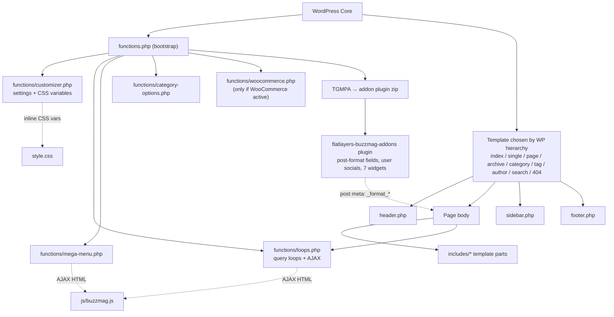
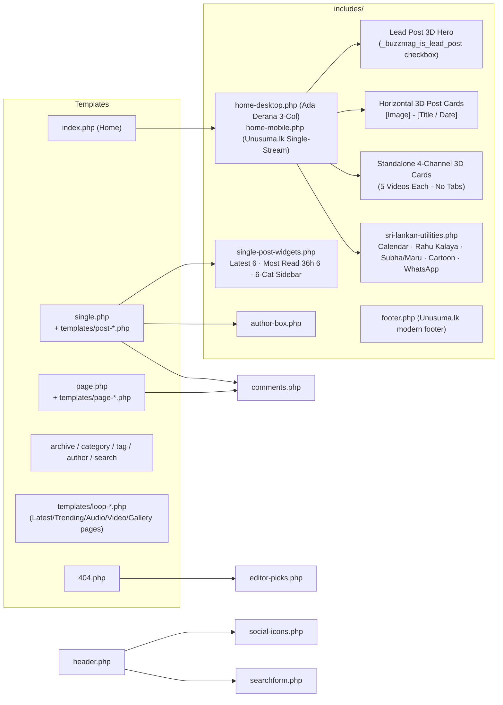
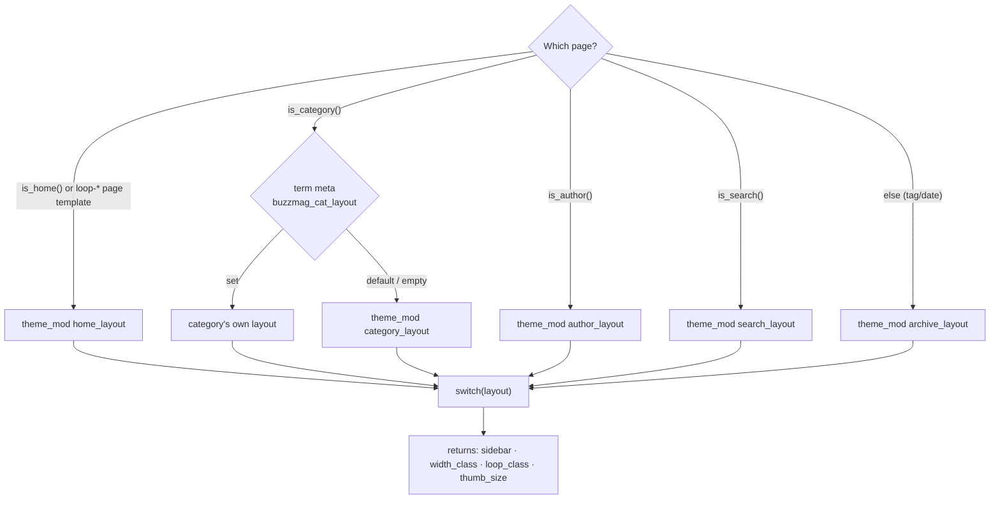
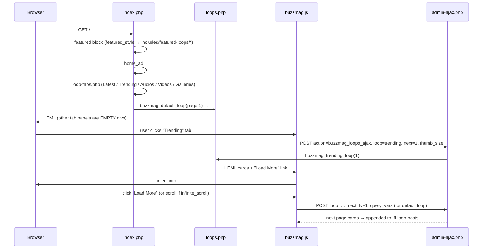
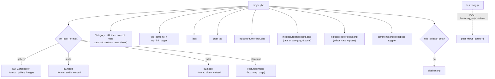
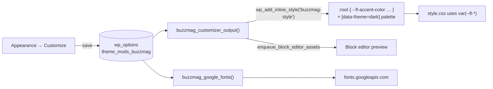
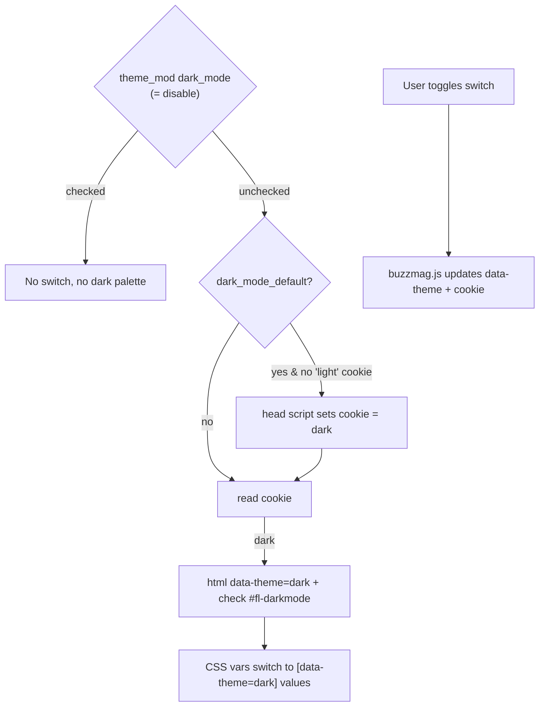
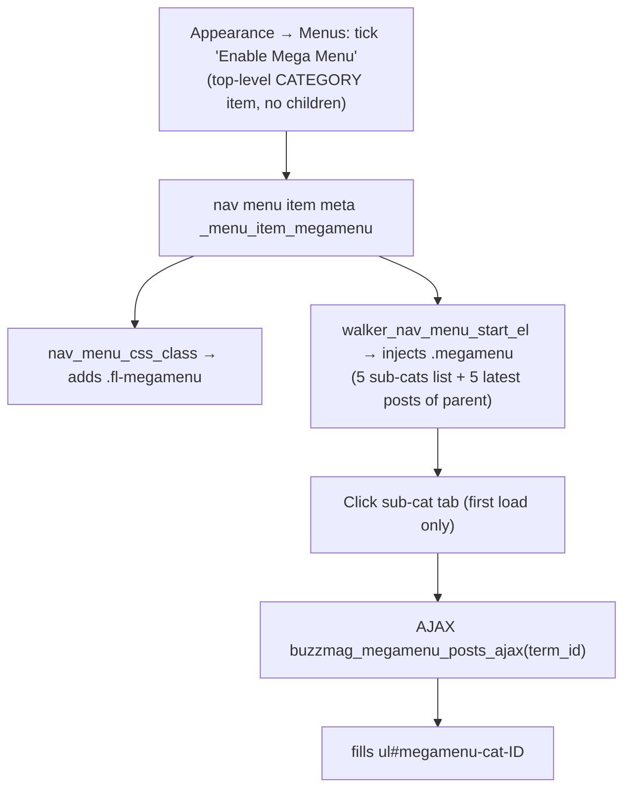
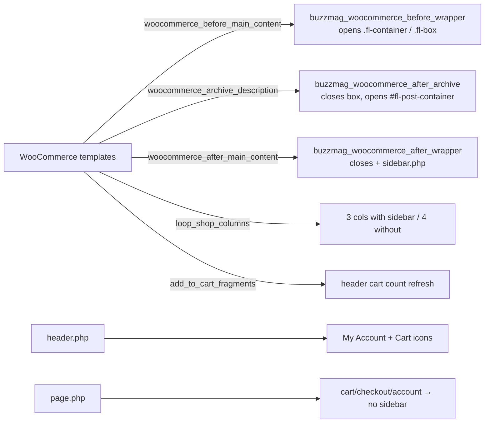

# COMPONENT MAP: How the Theme Works

> Visual map of how the pieces connect. Diagrams use Mermaid (they render in VS Code with a Mermaid preview extension, and on GitHub/GitLab).
> For file-by-file details see [`PROJECT_MEMORY.md`](PROJECT_MEMORY.md).

---

## 1. Big Picture



---

## 2. Page Skeleton (every front-end page)

```
┌──────────────────────────── header.php ─────────────────────────────┐
│ #fl-top (scroll-to-top button)                                       │
│ <header id="fl-header">                                              │
│   [☰ #fl-drawer-icon] [#fl-logo] [#fl-topmenu main-menu + megamenu]  │
│   [.header-icons: social | account | cart | dark switch | search]   │
│ </header>                                                            │
│ #fl-drawer  ← "Drawer" widget area (off-canvas)                      │
│ .push-overlay   #fl-search-overlay (search form + top 7 categories)  │
│ <div id="fl-main-warp">                                              │
├────────────────────────── template body ────────────────────────────┤
│  .fl-container                                                       │
│   ┌──────────── #fl-post-container ───────────┐ ┌── #fl-sidebar ──┐ │
│   │ content / loops                           │ │ sidebar.php     │ │
│   └───────────────────────────────────────────┘ └─────────────────┘ │
├──────────────────────────── footer.php ─────────────────────────────┤
│ </div> (closes #fl-main-warp)                                        │
│ .fl-ad (footer_ad)                                                   │
│ <footer id="fl-footer">  3× footer widget columns                    │
│   #fl-copyright: footer-menu + copyright text                        │
└──────────────────────────────────────────────────────────────────────┘
```

---

## 3. Template → Template-Part Map



---

## 4. Layout Engine: `buzzmag_layout_settings()` (functions.php L281)

Decides **sidebar on/off**, **container width class**, **loop CSS class**, and **thumbnail size** for every listing page.



| Layout key | Sidebar | Loop class | Thumb |
|---|---|---|---|
| `grid` | ✗ | `fl-grid` | medium |
| `grid_sidebar` (default) | ✓ | `fl-grid` | medium |
| `grid_col_3` | ✗ | `fl-grid col-3` | medium |
| `list` / `list_sidebar` | ✗ / ✓ | `fl-list` | medium |
| `masonry` / `masonry_sidebar` | ✗ / ✓ | `fl-grid fl-masonry` | masonry |
| `masonry_col_3` | ✗ | `fl-grid col-3 fl-masonry` | masonry |
| `standard` / `standard_sidebar` | ✗ / ✓ | `fl-standard` | large |

No sidebar → `width_class = fl-full-width`.

---

## 5. Homepage Render + AJAX Tabs



**Loop queries (loops.php):**
| Loop | Query |
|---|---|
| default | current page's main query (`$wp_query->query`) |
| latest | all posts |
| trending | `meta_key=post_views_count` desc, published in last `trending_date` days |
| audio / video / gallery | `post_format` taxonomy |

---

## 6. Single Post Composition (`single.php`)



Post templates `post-full-width / post-sidebar-left / post-sidebar-right` are **copies** of `single.php` with a fixed sidebar setting. Any change to single.php must be repeated in these 3 files.

---

## 7. JavaScript Behaviour Map (`js/buzzmag.js`)

| Feature | Trigger / selector | Notes |
|---|---|---|
| Dark mode switch | `#fl-darkmode` change | sets `<html data-theme>` + cookie `buzzmag_color_theme` |
| Search overlay | `#fl-topsearch` click | fades `#fl-search-overlay` |
| Drawer | `#fl-drawer-icon`, `.push-overlay` | toggles `.open` on `#fl-drawer` |
| FitVids | `.fl-media-wrap` | responsive video embeds |
| Widget menu accordion | `.fl-widget .menu .arrow` | |
| Header offset | `#fl-header` fixed + `#wpadminbar` | used by sticky tabs/sidebar/scrolls |
| Sticky sidebar | `.fl-sticky-sidebar` | Theia Sticky Sidebar |
| Scroll-to-top | `#fl-top` | |
| Gallery slider | `.fl-gallery` | Owl Carousel, RTL-aware |
| Comments toggle | `.fl-comments-toggle`, `.fl-meta a.comments` | |
| Masonry | `.fl-masonry .fl-loop-posts` | re-run after each AJAX load |
| Views counter | `body.single-post` | AJAX `buzzmag_setpostviews` |
| Mega menu tabs | `.fl-megamenu .cats-list .cat-link` | AJAX `buzzmag_megamenu_posts_ajax` |
| Loop tabs | `.fl-loop-tabs a` | AJAX `buzzmag_loops_ajax` |
| Load more / infinite | `.fl-load-more(.infinite)` | AJAX `buzzmag_loops_ajax` |

---

## 8. Customizer → CSS Pipeline



---

## 9. Dark Mode Flow



---

## 10. Mega Menu Flow



---

## 11. WooCommerce Integration (only if the plugin is active)



---

## 12. "Where do I change…?" Quick Lookup

| I want to change… | Edit |
|---|---|
| Theme name / author shown in admin | `style.css` header, `readme.txt`, `screenshot.png` |
| Logo | Customizer → Header Settings (or the fallback text in `header.php` L38–44) |
| Brand colours | Customizer defaults in `functions/customizer.php` (setting + `buzzmag_customizer_output`) |
| Dark mode colours | `functions/customizer.php` L1210–1230 |
| Fonts | Customizer Typography defaults + `buzzmag_google_fonts()` in `functions.php` |
| Header layout/icons | `header.php` + style.css §4 |
| Footer / copyright | `footer.php` + customizer `copyrights` default |
| Post card look | `includes/loop-post.php` + style.css §6 |
| Featured (hero) block | `includes/featured-loops/*` + style.css §5 |
| Single post layout | `single.php` **and** the 3 `templates/post-*.php` copies |
| Home tabs | `index.php`, `includes/loop-tabs.php`, `loops.php`, `buzzmag.js` |
| Ads | `index.php`, `footer.php`, `single.php`, `templates/post-*.php` defaults |
| Widgets list | inside the addon plugin zip |
| Translations | `languages/` (regenerate .pot with Poedit / WP-CLI `wp i18n make-pot`) |
